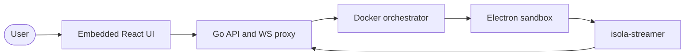

<div align="center">


# 🏝️ isola

**isolated browser sandbox**

[](https://buymeacoffee.com/dm0xa)

[](https://go.dev/)
[](https://reactjs.org/)
[](LICENSE)
[](https://www.docker.com/)


Isola boots a throwaway Docker container with offscreen Chromium, streams it to your browser over Isola transport (H.264 on WebSocket), and tears the container down the moment you close it. No cookies, history, or state carry over, and any session can be routed over Tor. It's built for looking at untrusted pages without ever putting them on your machine.


</div>

---

## Why Isola

Most "run a browser somewhere else" setups get the demo working and then run into the same handful of walls.

| The problem | What Isola does |
| :--- | :--- |
| **Automation runs with your credentials.** Whatever the browser can reach, the page can reach — your cookies, your logged-in dashboards, your LAN, your cloud metadata endpoint. One hostile page is one incident. | Every session is a throwaway container: read-only rootfs, capabilities dropped to the minimum the sandbox needs, `no-new-privileges`, a non-root user, and a **fail-closed egress firewall** (HTTP, HTTPS, DNS, NTP only; RFC1918/ULA blocked). It refuses to start without an enforcing AppArmor/SELinux profile. |
| **VNC and WebRTC are the wrong shape for a web app.** VNC ships pixels but needs a client, a websockify bridge and another port, and input feels remote. WebRTC needs ICE, TURN, signalling and a relay fleet — and finds its way around proxies in ways you did not plan for. | Video is **H.264 over the same WebSocket as everything else** (`channel=isola`) and decoded in the tab with WebCodecs (MSE fallback); input is JSON dispatched to CDP (`channel=input`). No VNC, no TURN — **one port, one TLS certificate, one firewall rule**. |
| **Clicks stop at iframes.** Synthetic OS-level clicks land on the parent `<iframe>`; the cross-origin child — a video player, a captcha, a payment widget — never sees them. The picture updates, the click does nothing. | Input is dispatched on the **iframe's own CDP target**, so cross-origin embeds receive real events. |
| **You cannot see what actually happened.** A screenshot at the end says nothing about the redirect chain, the third-party calls, the cookies that were set, or where a host really resolved. | CDP traffic is streamed beside the video: every request (method, status, type, size, source IP), a request graph, per-host IPs, console output and cookies — attributed per browser tab and flagged when something looks off. Scripts get the same log over MCP. |
| **State bleeds between tasks.** A long-lived shared browser accumulates logins and tabs, so yesterday's session becomes today's leak — into the next task, or into an agent's context. | **A new container per session, destroyed on close.** No cookies, history or tabs carry over, and a session can be routed over Tor for IP-level separation. |
| **Handing someone your live session hands them your session.** Demos, reviews and support need a second pair of eyes, not a shared cookie jar. | **View-only share links** with their own token, resolvable and revocable per session. |
| **Agents need a browser without becoming a liability.** A model that can click anything in a logged-in browser can click *anything*. | MCP exposes a **bounded surface** — `snapshot` (accessibility tree with refs), `screenshot`, `inspect_session`, `navigate`, `click`, `type`, `get_network` — never raw CDP or WebDriver. The sandbox confines whatever the model gets wrong. |
| **A browser per user is heavy; a shared browser is unsafe.** VMs are slow to provision and costly to leave idle; a shared pool gives back exactly the isolation you wanted. | One container per session with **hard caps** (RAM, CPU, PIDs), an optional **warm pool** for instant starts, and **multisession with an admission cap** that answers `429` + `Retry-After` instead of thrashing the host. The CPU cap fits itself to a host with fewer cores than the default. |
| **The operational surface keeps growing.** A VNC broker, a TURN server, media relays, an orchestrator, a browser fleet. | **One Go binary** with the UI embedded, plus one build-time sandbox image and a single Compose file. No external services, no extra ports. |

The whole design follows from one constraint: the browser you are looking at should **never be your browser**. The transport, the traffic panel, the timers and the caps all exist to keep that true while still being usable from a tab.

---

## Features

- **Disposable containers** — Wiped on close. Seccomp, dropped capabilities, read-only rootfs.
- **Electron sandbox** — Offscreen Chromium in Docker (`isola-browser:electron`).
- **Isola transport** — H.264 Annex-B over WebSocket; JSON input to CDP. No VNC, no WebRTC. See [docs/transport.md](./docs/transport.md).
- **Traffic panel** — Per-tab requests, request graph, domains, console and cookies, captured over CDP and streamed beside the video. See [Traffic panel](#traffic-panel).
- **One TCP port** — UI, API, and WebSocket relay share a single port (default `8080`), so it drops cleanly behind a reverse proxy with one hostname, one TLS certificate, and one firewall rule — no extra media or VNC ports to open.
- **Optional Tor** — SOCKS for the session.
- **Share links** — View-only tokens.
- **Timers and idle reaper** — Configurable session length and inactivity kill.
- **REST API** — Create, extend, delete, metrics.
- **MCP** — Streamable HTTP at `POST /mcp`.

---

## Requirements

Isola is two pieces with different footprints — the **control plane** (the `isola` process: UI, API, WebSocket relay) and the per-session **browser sandbox** (a container).

**Control plane**

| | Minimum | Recommended |
| :--- | :--- | :--- |
| CPU | 1 vCPU | 2 vCPU |
| RAM | 128 MB | 256 MB |
| Disk | ~50 MB | ~100 MB |
| OS | Linux (x86-64/arm64) or macOS | — |
| Network | one TCP port (default `8080`) | — |

The process itself is tiny — a single Go binary, **~16 MB RSS idle**. The figures above are host headroom, not the process footprint. It runs with **no Docker and no browser** — the UI and API come up, but sessions cannot launch until the sandbox is available.

**Per concurrent browser session** — each session is a Docker container hard-capped at **2 GB RAM** (`--memory 2g`), **3 CPU** (`--cpus 3`) and **512 PIDs** (all three configurable: `ISOLA_SESSION_MEMORY_MB`, `ISOLA_SESSION_CPUS`, `ISOLA_SESSION_PIDS`). Idle (an empty page) measures **~320 MB**; budget **~1–2 GB RAM** per active session depending on the page. The shared `isola-browser:electron` image is ~1.2 GB of host disk, and each pre-started ("warm") container costs one session's RAM more. The CPU cap can never exceed the host's core count — the Docker daemon refuses `--cpus` above it — so a host with fewer than 3 cores defaults to its core count, and an explicit `ISOLA_SESSION_CPUS` must not be higher.

**Full stack (to actually launch sessions):** Docker 24+ with BuildKit + Compose v2, the `docker` **CLI on `PATH`** (isola drives Docker through the CLI, not the socket API directly) and access to `/var/run/docker.sock`. Session containers join a Docker network named `browser-net`, which the Compose stack creates and a binary-only install must create itself (`docker network create browser-net`). Add the container images — `isola` ~82 MB and `isola-browser:electron` ~1.2 GB — so budget **≥5 GB** with build cache. Recommended host for a small deployment (2–3 concurrent sessions): **4+ vCPU, 8+ GB RAM, 20+ GB disk**.

**All-in-one server** (control plane + Docker + sandboxes on one host) — size by concurrency at **~2 GB RAM and ~1–2 vCPU per session**, plus **~2 GB** baseline for the OS, Docker and the control plane:

| Concurrent sessions | vCPU | RAM |
| :--- | :--- | :--- |
| 2–3 | 4 | 8 GB |
| ~5 | 8 | 16 GB |
| ~10 | 16 | 32 GB |

So a **16 GB / 8 vCPU** all-in-one host comfortably runs about **5 concurrent sessions** (more if the pages are light — idle sessions measure ~320 MB, so the 2 GB cap is a worst case).

isola is **multisession by default** — each launch adds a session and nothing tears down the caller's other ones. Set `ISOLA_MAX_SESSIONS` to the number the host can hold; launches past it get HTTP `429` (`max_sessions_reached`). See [Configuration → Cap concurrent sessions](./docs/configuration.md#cap-concurrent-sessions).

Details: [Getting Started → Requirements](./docs/getting-started.md#requirements).

---

## Quick Start

### Installer

Downloads `isola`, verifies the SHA-256 in `checksums.txt`, and can install a systemd unit or LaunchAgent. It prompts to install Docker if missing, then fetches the per-session sandbox image at the tag matching this release (`ghcr.io/dm0xa/isola-browser:v<version>`), falling back to the floating `:electron` tag and then to a local build from a checkout. `ISOLA_BROWSER_IMAGE_REMOTE` pins one exact reference (empty skips the registry); the image the binary actually launches is set with `ISOLA_BROWSER_IMAGE`.

```bash
curl -fsSL https://raw.githubusercontent.com/dm0xa/isola/main/scripts/install.sh | bash
```

Read it first: `curl -fsSL https://raw.githubusercontent.com/dm0xa/isola/main/scripts/install.sh | less`. In-repo source: [`scripts/install.sh`](./scripts/install.sh). `ISOLA_INSTALL_DIR` / `ISOLA_VERSION` override the install location and version; the default is `/opt/isola`, falling back to `~/.isola` when the invoking user cannot write it. Service environment lives in `<install dir>/isola.env`. The installer reports whether the host enforces an AppArmor/SELinux profile — sessions fail closed without one, until you set `ISOLA_REQUIRE_MAC=0` (not recommended). Then open <http://localhost:8080>.

Prefer not to pipe a script to a shell? [Manual install](./docs/deployment.md#manual-install) does the same thing by hand — download the release tarball, verify its SHA-256, pull the sandbox image and create the network.

### From source

Needs **BuildKit** and **Compose v2**. This is also how you build `isola-browser:electron`.

```bash
git clone https://github.com/dm0xa/isola.git
cd isola
docker compose up --build
```

Open <http://localhost:8080>. One process serves the embedded UI, the API, and the WebSocket relay.

The first `up --build` compiles the frontend and Go binary into **`isola`**, and builds **`isola-browser:electron`** (the per-session sandbox). Later starts reuse cached layers. No `.env` is required.

### Customization (optional)

```bash
cp .env.example .env
# edit .env, then:
docker compose up --build
```

Every variable is documented in [`.env.example`](./.env.example). Full reference: [docs/configuration.md](./docs/configuration.md).

### CLI shortcuts (optional)

```bash
brew install just          # macOS
just up                    # docker compose up --build -d
just logs                  # docker compose logs -f
just down                  # docker compose down
```

---

## Development

Go 1.26+, Node 20+, and [Just](https://github.com/casey/just):

```bash
cp .env.example .env
just setup                  # npm install + go mod tidy + build frontend
just build-backend          # API-only host (`backend/isola`); UI embed is cmd/single-user
just test-backend           # go test ./...
```

Binaries, gitignore names, and helpers: [docs/binaries.md](./docs/binaries.md).

This repository is self-contained: it builds and tests on its own. The `just` recipes skip any tree that is not present in this checkout.

The Compose file is [`docker-compose.yml`](./docker-compose.yml). The local full stack (`just up-dev`: nginx + Vite + backend) is [`deploy/docker-compose.yml`](./deploy/docker-compose.yml).

---

## Architecture



| Component | Technology | Role |
| :--- | :--- | :--- |
| **Frontend** | React 18 + Vite + TypeScript + Tailwind | SPA, embedded in the Go binary. |
| **API** | Go (`chi`) | Session lifecycle and shares. |
| **WS relay** | Go (`gorilla/websocket`) | Duplex to `isola-streamer`. See [`proxy.go`](./backend/pkg/wsproxy/proxy.go). |
| **Orchestrator** | Go Docker client | Creates and kills session containers. See [`orchestrator.go`](./backend/pkg/orchestrator/orchestrator.go). |
| **Store** | In-memory | Session routing with TTL. |
| **Browser node** | Electron + `isola-streamer` | Offscreen capture, H.264, WebSocket on container port 5900. |

More: [docs/architecture.md](./docs/architecture.md).

---

## Security

Defense in depth so a hostile page stays in the box:

- **Network** — Session containers join `browser-net`. Isola itself publishes **8080**. Streamer **5900** and the CDP relay **9223** are bound to loopback on the host, not `0.0.0.0`.
- **Outbound firewall** — Per-container `iptables` / `ip6tables` (fail-closed): HTTP, HTTPS, DNS, NTP; RFC1918 / ULA blocked.
- **Inbound ACL** — 5900/9223 accept the backend peer only (`ISOLA_PROXY_IP` or the container gateway).
- **Capabilities** — `--cap-drop ALL`, then the minimum needed for the sandbox.
- **Read-only rootfs** — `tmpfs` for `/tmp`, `/run`, `/home/isolauser`.
- **Non-root** — Entrypoint sets the firewall as root, then `gosu isolauser`. `no-new-privileges`.
- **CDP** — Chromium debug port is `127.0.0.1` inside the container.
- **Seccomp + limits** — Memory, CPU, PIDs.

Full list: [docs/security.md](./docs/security.md).

---

## Streaming

Video and audio on `channel=isola`; mouse/keys/tabs on `channel=input` so input is not stuck behind frames. Packet layout, `stream_init` / `stream_reset`, and ABR: [docs/transport.md](./docs/transport.md).

| | Isola |
| :--- | :--- |
| **Encode** | H.264 (offscreen → ffmpeg). Annex-B for WebCodecs; fMP4 for MSE. |
| **Decode** | `VideoDecoder` → canvas (MSE fallback). |
| **Audio** | Opus → `AudioDecoder` → `AudioContext` (opt-in per session). |
| **Input** | JSON → CDP `Input.*` |
| **Bitrate** | Scales with capture area (6 Mbps @ 720p, 2 Mbps floor). Viewer ABR via `set_bitrate`. |

A frozen picture is usually a blocked renderer or empty paint captures; Isola detects those and recovers. If frames keep flowing but the page never changes, that is the page, not the transport. Details and env knobs: [docs/troubleshooting.md](./docs/troubleshooting.md#the-stream-is-blank-or-frozen). Chromium shm must stay in `/dev/shm` — do not add `--disable-dev-shm-usage` (see [`chrome_flags.js`](./browsers/electron-runner/src/chrome_flags.js)).

Warm pool and DNS (plain / DoT / DoH) are configured in [`backend/config.yaml`](./backend/config.yaml). See [docs/configuration.md](./docs/configuration.md).

---

## Traffic panel

Isola streams CDP traffic to the viewer alongside the video, so a page can be inspected from the sandbox rather than from your machine. The **Analysis** panel docks under or beside the canvas, pops out into its own browser tab, and is also a full page at `/session/<id>/network`. Five tabs:

| Tab | What it shows |
| :--- | :--- |
| **Network** | Every request — method, status, resource type, size, source IP — filterable by browser tab, text, method, status family and resource type. |
| **Graph** | The request chain (initiator → host → resource) as a diagram, colour-coded by resource class with per-class facets. |
| **Domains** | One row per host: request count, bytes and the IPs it resolved to, expandable to that host's most recent requests. |
| **Console** | Console output for the selected browser tab, with errors and warnings highlighted. |
| **Cookies** | Name, value, domain, path, expiry, SameSite and flags. |

Requests are flagged when they are worth a second look — an IP-literal host, plain `http`, a risky TLD, a random-looking hostname, an odd port — and the `flagged` filter narrows the list to just those; a domain row inherits the flags of its worst request.

| Requests | Request graph |
| :--- | :--- |
|  |  |

The panel is view-only: raw CDP is not exposed to the client. The same log is available to scripts through MCP `get_network` ([docs/automation.md](./docs/automation.md)), and the panel is only available for sessions created with `network_monitor` ([docs/api.md](./docs/api.md)). The graph can also be rendered headlessly — `GET /api/sessions/{id}/graph.png` or the MCP `resource_graph` tool, both with a `theme` of `dark` or `light`.

---

## API

OpenAPI: `GET /api/openapi.json`. Narrative: [docs/api.md](./docs/api.md).

| Method | Path | Auth | Description |
| :--- | :--- | :--- | :--- |
| `POST` | `/api/sessions` | Optional API token | Create (`bandwidth_kbps`, `framerate`, …) |
| `GET` | `/api/sessions/:id` | Session token | Details. `cdp_url` is the **input WebSocket**, not Chrome DevTools. |
| `DELETE` | `/api/sessions/:id` | Session token | Destroy the container |
| `PATCH` | `/api/sessions/:id` | Session token | Extend TTL |
| `WS` | `/ws/:sessionId` | Session token | `channel=isola` (video) or `channel=input` |
| `POST` | `/mcp` | Bearer | MCP (opt-in) |

- **API create token** (optional): `Authorization: Bearer <token>` on `POST /api/sessions` when `ISOLA_API_TOKEN` / `api.token` is set (one or more, each ≥ 32 chars).
- **Session token**: `X-Session-Token` header. Returned at create. (The `?session_token=` query form is accepted only on the WebSocket handshake, never on the HTTP API.)

```bash
curl -X POST http://localhost:8080/api/sessions \
  -H "Content-Type: application/json" \
  -d '{"url": "about:blank"}'
```

```
ws://localhost:8080/ws/<SESSION_ID>?channel=isola&session_token=<SESSION_TOKEN>
ws://localhost:8080/ws/<SESSION_ID>?channel=input&host=1&session_token=<SESSION_TOKEN>
```

```json
{"type": "mousemove", "x": 640, "y": 360, "buttons": 0}
{"type": "mousedown", "x": 640, "y": 360, "button": "left"}
{"type": "type", "text": "hello"}
{"type": "tab_new"}
```

Raw CDP / WebDriver BiDi is not exposed. Input messages: [docs/automation.md](./docs/automation.md#session-websocket-custom-clients).

---

## MCP

Off unless `ISOLA_MCP_ENABLED=true` and at least one `ISOLA_MCP_TOKEN` is ≥ 32 characters (startup fails if MCP is on without a usable token). Several tokens may be listed. Streamable HTTP at `POST /mcp`. Tools: `create_session`, `navigate`, `inspect_session`, `snapshot`, `screenshot`, `click`, `type`, `get_network`, `get_links`, `close_session`.

Any MCP client works: point it at `POST /mcp` with `Authorization: Bearer <token>`.

Full setup: [docs/automation.md](./docs/automation.md).

---

## Documentation

- [Getting started](./docs/getting-started.md)
- [Configuration](./docs/configuration.md) · [`backend/config.yaml`](./backend/config.yaml) · [`.env.example`](./.env.example)
- [Architecture](./docs/architecture.md) · [Transport](./docs/transport.md) · [Binaries](./docs/binaries.md)
- [API](./docs/api.md) · [Automation](./docs/automation.md)
- [Security](./docs/security.md) · [Deployment](./docs/deployment.md)
- [Troubleshooting](./docs/troubleshooting.md) · [docs index](./docs/README.md)

---

## License

Isola is MIT. See [LICENSE](LICENSE).

Security reports: [SECURITY.md](SECURITY.md). Contributions: [CONTRIBUTING.md](CONTRIBUTING.md).
