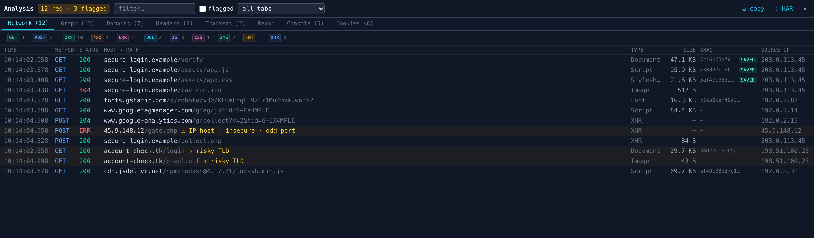
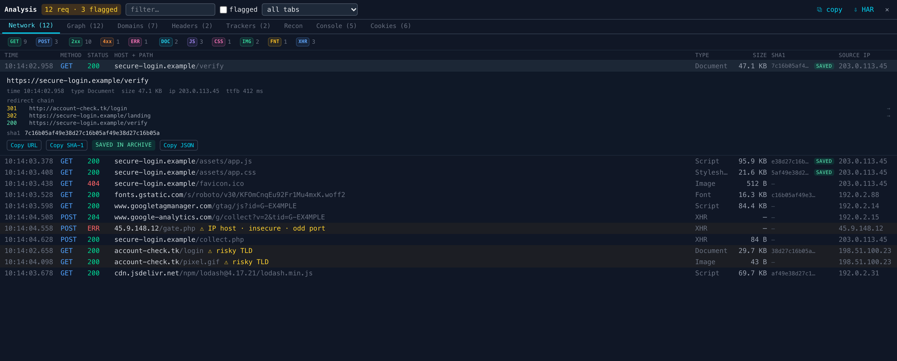
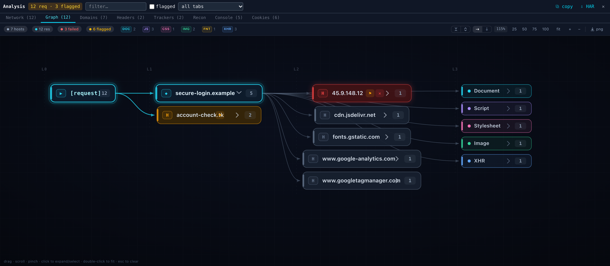
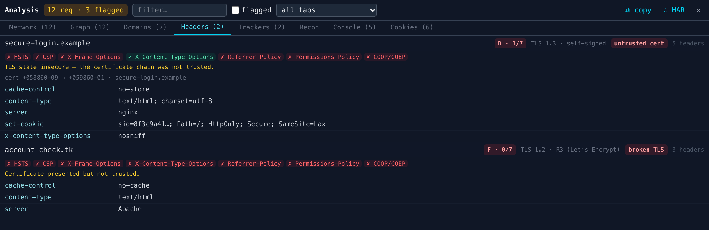
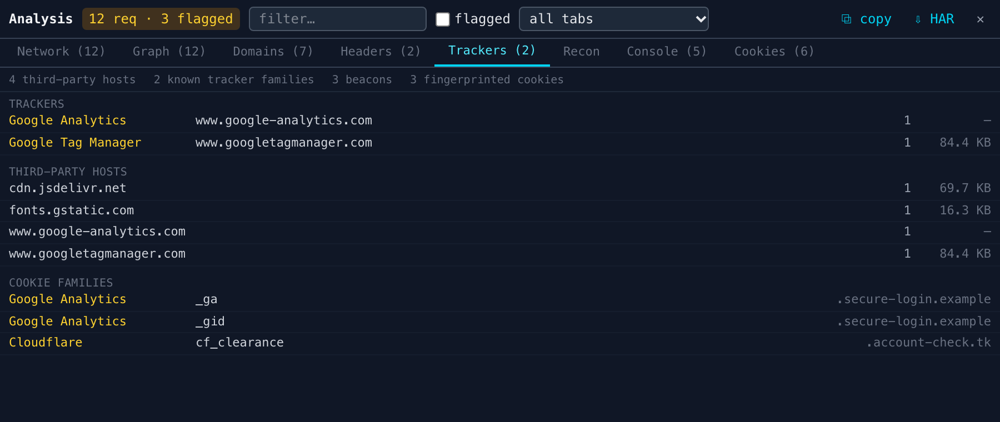
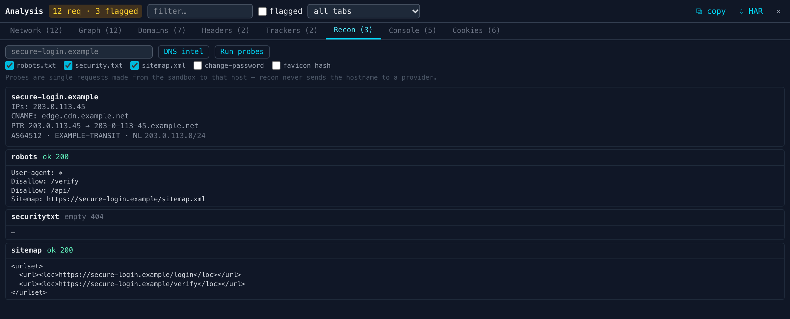
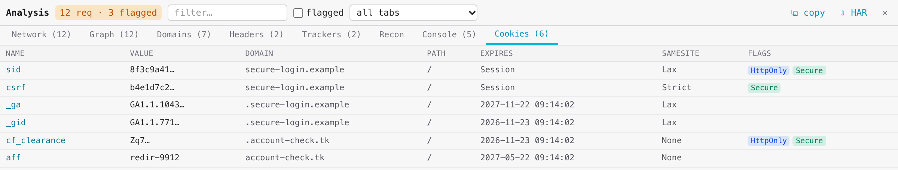
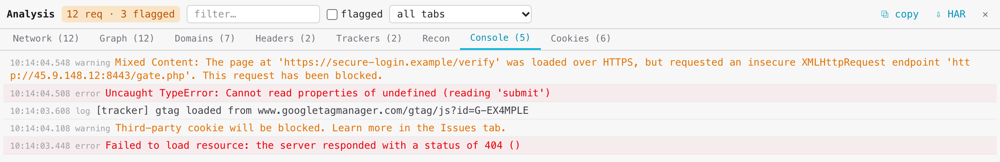

<div align="center">


# isola

**throwaway browser sandboxes for hostile pages**

[](https://buymeacoffee.com/dm0xa)

[](https://go.dev/)
[](https://www.docker.com/)
[](LICENSE)

</div>

Isola opens an untrusted page inside a disposable Docker container, streams the
browser to your tab over H.264 on a WebSocket, and destroys the container when
you close it. The page never gets your workstation's cookies, saved logins or
LAN reach. Around that isolated browser it exposes what a responder actually
needs: every request with its response headers and TLS verdict where available,
the redirect chain, tracker and beacon labels, plus on-demand host recon,
response-body capture and view-only evidence links.

The design follows one rule: **the browser you are looking at must never be yours.**

---

## Jobs it fits

| Job | What you use |
| :--- | :--- |
| **Phishing / suspicious link triage.** Decide whether a link is hostile without asking your workstation to resolve it. | Throwaway session, redirect chain, per-request status + source IP, TLS `security_state`, security-header posture, cookie jar, Tor if the page should not see your IP. |
| **Drive-by and tracker analysis.** See who the page contacts, not just what it rendered. | Request graph, per-host resolved IPs, first/third-party and known tracker/beacon families, console output, flag filters for IP-literal hosts, plain `http`, risky TLDs, random-looking names and odd ports. |
| **Infrastructure recon from the sandbox.** Pivot from a host you found in traffic to its infrastructure. | Passive DNS/PTR/CNAME/ASN, bounded active checks (`robots.txt`, `sitemap`, `security.txt`, `/.well-known`, favicon hash), all fetched from inside the sandbox. |
| **Authenticated review without giving up your session.** Reproduce an issue behind a login without exporting your own browser state. | `POST /api/sessions/{id}/seed` (or **Custom data…**) injects cookies, extra request headers and `localStorage`/`sessionStorage` into the live page; nothing is logged or stored on the host. |
| **Evidence and hand-off.** Put reproducible artefacts in a ticket. | **Record** archive of every response body (URL, status, MIME, sizes, SHA-256, URL-shaped file tree), `graph.png`, screenshots, and a revocable **view-only** share link. |
| **Scripted or agent-driven triage.** Run the same checks without a human clicking. | REST `GET /api/sessions/{id}/network` (traffic log with `type`/`host_contains`/`url_contains`/`limit`), or MCP at `POST /mcp` with a bounded tool surface (`get_network`, `get_headers`, `get_posture`, `host_intel`, `probe_host`, `resource_graph`, `get_links`, `snapshot`, `screenshot`, …). No raw CDP/WebDriver. |
| **Region-conditional behaviour.** A page behaves differently by locale or timezone. | Per-session `timezone` + `locale`, sandbox never looks like one fixed geography. |

---

## Isolation

Everything below is enforced per session (see [`docs/security.md`](./docs/security.md) and
[`security_args.go`](./backend/pkg/orchestrator/security_args.go)):

- **Throwaway container.** One container per session, created on launch, destroyed on close. No cookies, history, downloads or tabs survive.
- **No mount and no sysctl.** `--cap-drop ALL` with only the eight capabilities the entrypoint needs, and **not** `SYS_ADMIN` — so a compromised in-container root cannot unmount the read-only `/proc` masks, write `kernel.core_pattern`, or mount `/proc/kcore`.
- **Read-only rootfs**, `tmpfs` for `/tmp`, `/run`, `/var/run`, `/home/isolauser` and a `/dev/shm` sized from the session resolution. `no-new-privileges`. Workload runs as `isolauser` after the firewall is applied.
- **Fail-closed egress.** `iptables` **and** `ip6tables` permit HTTP, HTTPS, DNS and NTP only, and block RFC1918/ULA, so a page cannot probe your LAN or cloud metadata. Startup fails if the rules cannot be applied.
- **Fail-closed LSM.** The entrypoint refuses to serve a sandbox unless AppArmor's `docker-default` or SELinux's container policy is enforcing (`ISOLA_REQUIRE_MAC=0` overrides — don't).
- **Ports.** `8080` is the only externally reachable port. Streamer `5900` and the CDP relay `9223` are published to loopback only. Inside the container, 5900/9223 accept the backend peer only, and Chromium's debugger is `127.0.0.1`.
- **Hard caps.** `--memory 2g --memory-swap 2g`, `--cpus 3`, `--pids-limit 512` by default — DoS guards, configurable per deployment.
- **No anon session access.** A session token grants view + control; a share token is view-only and gets `403` on input or control. A session id alone is never enough. (Creation is open unless `ISOLA_API_TOKEN` gates `POST /api/sessions`.)
- **Credential handling.** Seeded cookies/headers/storage go once to the sandbox over loopback, are never logged, and are never persisted; responses carry counts only. Cookies are jar-wide for the seeded domain; extra headers are per tab and are dropped when the input channel re-attaches (a tab switch) — re-run the seed to restore them. Capture archives are the one exception that writes bytes to the host, and they are opt-in.

The sandbox browser **ignores certificate errors** on purpose: a phishing page
with a broken chain still renders, and the traffic panel reports CDP's own
`tls.security_state` (`insecure` / `insecure-broken` / `neutral`) instead of
pretending the transport was safe. Header posture grades are capped when the
transport is not trustworthy.

**Optional Tor.** A session can egress through SOCKS/Tor, with an optional exit
country applied via `StrictNodes` — a country with no reachable exit fails the
session rather than leaking elsewhere. This is **routing separation, not an
anonymity guarantee**; exit pinning narrows the exit pool.

---

## A triage, end to end

```bash
# 1. Launch — the container is created here.
curl -s -X POST http://localhost:8080/api/sessions \
  -H "Content-Type: application/json" \
  -d '{"url":"https://suspicious.example","network_monitor":true,
       "timezone":"Europe/Stockholm","locale":"sv-SE"}' | tee /tmp/s.json

ID=$(jq -r .id /tmp/s.json); TOKEN=$(jq -r .session_token /tmp/s.json)

# 2. Collect traffic with headers, TLS verdicts, redirects and tracker labels.
curl -s "http://localhost:8080/api/sessions/$ID/network?limit=200" \
  -H "X-Session-Token: $TOKEN"
#    Same document over MCP: get_network (same type/host_contains/url_contains/limit
#    filters). The viewer's Analysis panel shows the same log.

# 3. Recon a host seen in that traffic (passive first, active on request).
curl -s "http://localhost:8080/api/sessions/$ID/intel?host=suspicious.example&mode=dns" \
  -H "X-Session-Token: $TOKEN"

# 4. Render the request graph for the ticket.
curl -s -o graph.png "http://localhost:8080/api/sessions/$ID/graph.png?theme=light" \
  -H "X-Session-Token: $TOKEN"

# 5. Optional: record every downloaded body, stop, then export the archive.
REC=$(curl -s -X POST "http://localhost:8080/api/sessions/$ID/capture/start" \
  -H "X-Session-Token: $TOKEN")
ARCHIVE=$(jq -r .archive_id <<<"$REC"); KEY=$(jq -r .archive_key <<<"$REC")
# ... visit the page ...
curl -s -X POST "http://localhost:8080/api/sessions/$ID/capture/stop" -H "X-Session-Token: $TOKEN"
curl -s -o "$ARCHIVE.zip" "http://localhost:8080/api/captures/$ARCHIVE/download" \
  -H "Authorization: Bearer $KEY"
```

The same workflow exists in the UI (`Analysis` panel under the canvas, or
`/session/<id>/network`), over MCP, and as the REST calls above. The panel is
view-only; raw CDP is never exposed to the client.

---

## What the traffic view answers

| Tab | Question |
| :--- | :--- |
| **Network** | Every request: method, status, type, size, source IP; filter by tab, text, status family, type, or `flagged`. |
| **Graph** | The initiator → host → resource chain, colour-coded by resource class. |
| **Domains** | One row per host: request count, bytes, resolved IPs, and that host's latest requests. |
| **Headers** | Document response headers, TLS certificate summary, and a security-header posture grade (HSTS, CSP, frame protection, nosniff, Referrer-Policy, Permissions-Policy, COOP/COEP). |
| **Trackers** | Third-party hosts, known tracker families, beacons, cookie-family fingerprints. |
| **Recon** | On-demand passive DNS/PTR/ASN/CNAME plus bounded active probes. |
| **Console** | Console output for the selected tab, errors and warnings highlighted. |
| **Cookies** | Name, value, domain, path, expiry, SameSite, flags — what the page tried to plant. |

Requests carry redirect chains with each hop's status and TTFB, cache and
service-worker badges, first/third-party and tracker labels, and `origin_host`
(the navigation the request belongs to — an iframe inherits its parent). They
are flagged on IP-literal hosts, plain `http`, risky TLDs, random-looking
hostnames and odd ports; a domain row inherits its worst request's flags.

Recon is scoped so it can be used on a live host without surprises: passive mode
uses DNS only (Team Cymru TXT for ASN; WHOIS/43 is outside the allowlist), active
mode makes one bounded GET per check (8 s, 2 MiB, ≤3 redirects on the same
registrable domain), refuses targets resolving to a private address, and contacts
no third-party provider. The proxied reply is capped at 4 MiB and answers `502`
rather than a truncated `200`. Nothing leaves the sandbox until you name a host.

Screenshots below use a synthetic capture (`*.example` hosts, TEST-NET addresses,
documentation ASN) — no live host was visited, and every value is demo data.

| Requests — flags on the row | Row detail — 301→302 chain, TTFB, saved hash |
| :---: | :---: |
|  |  |
| **Request graph — pages, hosts, exfil node in red** | **Headers, posture and TLS verdict** |
|  |  |
| **Trackers, beacons and cookie families** | **Passive DNS and bounded probes** |
|  |  |
| **Cookie jar the page planted** | **Console errors and mixed content** |
|  |  |

---

## Evidence and hand-off

- **Record** (opt-in, `ISOLA_CAPTURE_ENABLED=true`) saves every response body the sandbox downloads, deduplicated by SHA-256, as a readable URL tree under `$ISOLA_DATA_DIR/captures/<session_id>/files/<host>/<path>…` with `index.txt` and `meta.json`. Archives survive the session and are downloadable individually or as a zip. Opt-in because they write real bytes to host disk; retention, per-file, per-session and total quotas are enforced.
- **Captured bytes are hostile.** They are served as `Content-Disposition: attachment` with `nosniff`, outside the app origin; the viewer previews text/images only and shows HTML as source.
- **Blind spots, by construction:** memory-cache hits, `blob:`/`data:` payloads, media responses, WebSocket/SSE frames, POST bodies, worker/OOPIF traffic, and everything after a container crash mid-record.
- **Share links** are view-only, per session, listable and revocable. Send one to a second responder instead of your token.
- **`graph.png`** renders the captured network headlessly (`theme=dark|light`) for a ticket or report; MCP `resource_graph` returns the same image.

---

## Interfaces

| Method | Path | Auth | Purpose |
| :--- | :--- | :--- | :--- |
| `POST` | `/api/sessions` | optional bearer | Create (`url`, `network_monitor`, `tor_enabled`, `timezone`, `locale`, `bandwidth_kbps`, …) |
| `GET` / `DELETE` / `PATCH` | `/api/sessions/{id}` | session token | Inspect, destroy, extend |
| `GET` | `/api/sessions/{id}/intel` | session token | Recon (`host`/`ips`, `mode=dns\|probe\|all`, `checks=…`) |
| `GET` | `/api/sessions/{id}/network` | session token | Traffic log: every request with headers, TLS verdict, redirects, tracker labels (`type`, `host_contains`, `url_contains`, `limit`) |
| `GET` | `/api/sessions/{id}/graph.png` | session token | Request-graph PNG |
| `POST` | `/api/sessions/{id}/seed` | session token | Inject cookies, headers, web storage into the live page |
| `POST` | `/api/sessions/{id}/capture/start\|stop` | session token | Record response bodies |
| `GET` | `/api/captures/{id}` … | archive key | Archive metadata, blobs, readable files, zip |
| `POST` / `GET` | `/api/sessions/{id}/shares` | session token | Create / list view-only links |
| `DELETE` | `/api/sessions/{id}/shares/{token}` | session token | Revoke one |
| `WS` | `/ws/{id}` | session token (query) | `channel=isola` video, `channel=input` mouse/keys/tabs |
| `POST` | `/mcp` | bearer | MCP, opt-in |

OpenAPI: `GET /api/openapi.json`. Narrative: [`docs/api.md`](./docs/api.md).
Input is JSON dispatched to CDP (`Input.*`); raw CDP/WebDriver is not exposed.
The traffic log — every entry whole, with its headers, TLS verdict, redirect
chain, `origin_host` and tracker/beacon labels — is available as
`GET /api/sessions/{id}/network` over REST and as MCP `get_network`, with the
same `type`/`host_contains`/`url_contains`/`limit` filters. MCP adds the shaped
projections (`get_headers`, `get_posture`, `get_redirects`, `get_trackers`,
`get_links`), and the panel renders all of it.

**MCP** is off unless `ISOLA_MCP_ENABLED=true` and a token of ≥32 characters is
set; startup fails otherwise. Tools: `create_session`, `navigate`,
`set_session_data`, `inspect_session`, `snapshot`, `screenshot`, `click`, `type`,
`get_network`, `get_headers`, `get_posture`, `get_redirects`, `get_trackers`,
`host_intel`, `probe_host`, `resource_graph`, `get_links`, `close_session`.

---

## Run it

**Installer** — downloads `isola`, verifies SHA-256 against `checksums.txt`,
optionally installs a systemd unit or LaunchAgent, pulls the sandbox image
(`ghcr.io/dm0xa/isola-browser:v<version>`), and reports whether the host enforces
an LSM profile.

```bash
curl -fsSL https://raw.githubusercontent.com/dm0xa/isola-browser/main/scripts/install.sh | bash
```

Read it first if you prefer: `curl -fsSL …/install.sh | less`, or use
[manual install](./docs/deployment.md#manual-install). Then open
<http://localhost:8080>.

**From source** — needs BuildKit and Compose v2:

```bash
git clone https://github.com/dm0xa/isola-browser.git
cd isola-browser
docker compose up --build
```

**Hard requirements:** Docker 24+ with the `docker` CLI on `PATH` and access to
`/var/run/docker.sock`, the `browser-net` bridge network, and an enforcing
AppArmor/SELinux profile on the host.

**Sizing.** Control plane: one Go binary, ~16 MB RSS idle, one TCP port.
Each session is hard-capped at 2 GB RAM / 3 CPU / 512 PIDs and measures ~320 MB
idle; budget ~1–2 GB per active page. All-in-one host: ~2 GB baseline plus
~2 GB RAM and 1–2 vCPU per concurrent session (4 vCPU / 8 GB ≈ 2–3 sessions;
8 vCPU / 16 GB ≈ 5). Set `ISOLA_MAX_SESSIONS`; launches past it get `429` with
`Retry-After` instead of thrashing the host. The image is ~1.2 GB of host disk.

**Before exposing it beyond localhost:** set `ISOLA_API_TOKEN` (each token ≥ 32
chars) and `RATE_LIMITING_ENABLED=true`, keep
`DISABLE_URL_VALIDATION=false`, enable MCP only with a strong token, set
`TRUSTED_PROXY_CIDRS` behind a proxy, and terminate TLS in front. The
community binary has no user accounts — API, session and share tokens are the
whole access model. Details:
[`docs/security.md`](./docs/security.md),
[`docs/deployment.md`](./docs/deployment.md),
[`docs/configuration.md`](./docs/configuration.md).

---

## Limits worth stating up front

- **Containers share the host kernel.** This is strong process isolation, not a VM; a kernel-level escape is out of scope. Dedicate the host and keep Docker and the kernel patched.
- **The control plane is not a trust boundary against local root.** It drives Docker through the socket, which is equivalent to host root; an RCE there is an incident. It is itself read-only, capability-free and resource-capped, but patch it like the internet-facing service it is.
- **Tor changes routing, not isolation strength.** Exit pinning reduces the anonymity Tor provides.
- **Capture is intentionally incomplete** (list above); for the full byte-level truth you still need a proxy you control.
- **The caps are DoS guards**, not tuning knobs; a page that needs more is constrained.
- **A share link is a bearer credential** — view-only, but still a credential. Revoke it when the review ends.

---

## Documentation

- [Getting started](./docs/getting-started.md) · [Deployment](./docs/deployment.md) · [Configuration](./docs/configuration.md)
- [Security model](./docs/security.md) · [Third parties](./docs/third-parties.md)
- [API](./docs/api.md) · [Automation / MCP](./docs/automation.md) · [MCP usage](./docs/skills/isola-mcp-usage/SKILL.md)
- [Architecture](./docs/architecture.md) · [Transport](./docs/transport.md) · [Troubleshooting](./docs/troubleshooting.md) · [docs index](./docs/README.md)

Isola is MIT — see [LICENSE](LICENSE). Report vulnerabilities privately per
[SECURITY.md](SECURITY.md); contributions follow [CONTRIBUTING.md](CONTRIBUTING.md).
