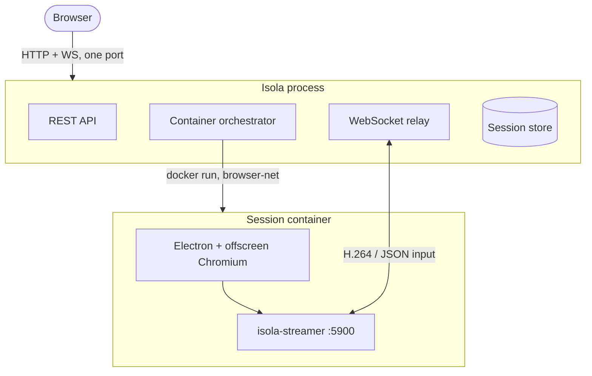

# Architecture

Isola is a single Go process that manages a fleet of short-lived browser containers over the Docker API. The process serves three things on one port: the embedded web UI, a REST API, and a WebSocket relay.

## Components

| Component | Technology | Role |
| :--- | :--- | :--- |
| **Frontend** | React 18 + Vite + TypeScript + Tailwind | Single-page app, embedded into the Go binary. |
| **API** | Go (`chi` router) | REST endpoints for session lifecycle and shares. |
| **WS relay** | Go (`gorilla/websocket`) | Duplex relay between the viewer and the container's streamer. |
| **Orchestrator** | Go (in-process Docker client) | Creates, inspects, and removes session containers with the hardening flags. |
| **Session store** | In-memory | Session routing and metadata; TTL-based in-memory storage. |
| **Session container** | Debian/Electron + `isola-streamer` | Offscreen Chromium capture, H.264 encode, WebSocket stream, CDP relay. |

## The Container Model

Two images are built:

- `isola` — the Isola process (embedded UI, API, WebSocket relay). Built from `backend/cmd/single-user`.
- `isola-browser:electron` — the per-session browser node (offscreen Electron/Chromium and `isola-streamer`). The seccomp profile lives in [`browsers/isola-base/seccomp.json`](../browsers/isola-base/seccomp.json); it is a file mounted into `isola`, not a Docker image.

When a session starts, the orchestrator runs one container from `isola-browser:electron` on a dedicated Docker network:

- `browser-net` — a hardened bridge the backend joins; inter-container communication is disabled so a compromised container cannot pivot laterally.
- **Ports are published to loopback only** — the streamer listens on `5900` and the CDP relay on `9223`, and both are bound to `127.0.0.1` on the host, so they are never reachable from outside the machine.
- **Outbound traffic** — restricted by `iptables` / `ip6tables` whitelists inside the container (HTTP/HTTPS/DNS/NTP); RFC1918 and ULA targets are blocked.
- **Inbound to 5900/9223** — limited to the backend peer; Chromium CDP listens on `127.0.0.1` only inside the container.

See [Security](security.md) for the full hardening list.

## Request Flow

1. The user opens the UI and submits a URL.
2. `POST /api/sessions` creates a session record and asks the orchestrator to start a container (or claims a pre-warmed one — see the [warm pool](configuration.md#warm_pool)).
3. The container boots, Electron starts the offscreen browser, and `isola-streamer` begins encoding to H.264.
4. The viewer opens `/ws/{sessionId}` (`channel=isola`) for video and a second socket with `channel=input` for input. The relay forwards both to the container's streamer.
5. On end/expiry, the orchestrator terminates the container and the session record is removed.

## The Streaming Path

- **Video** — Electron compositor → `isola-streamer` → ffmpeg H.264 (Annex-B) over WebSocket → browser `WebCodecs VideoDecoder` → canvas (with an MSE fallback). Encoder bitrate scales with capture resolution.
- **Audio** — Opus → `WebCodecs AudioDecoder` → `AudioContext`.
- **Input** — JSON over the `channel=input` socket → streamer → CDP `Input.`*.
- **Clipboard** — bidirectional, via the streamer and CDP.
- **Network monitor** — with `network_monitor` on create, CDP network events are streamed to the viewer's Network tab. The streamer also keeps the window itself: `GET /network` returns it as JSON, and `GET /graph.png` renders it as a PNG, both proxied by the control plane for the API and MCP surfaces.

Packet layout, `stream_init` / `stream_reset`, ABR, and how to write a custom viewer are in [Transport](transport.md). Host vs container binaries and local build names are in [Binaries](binaries.md).
